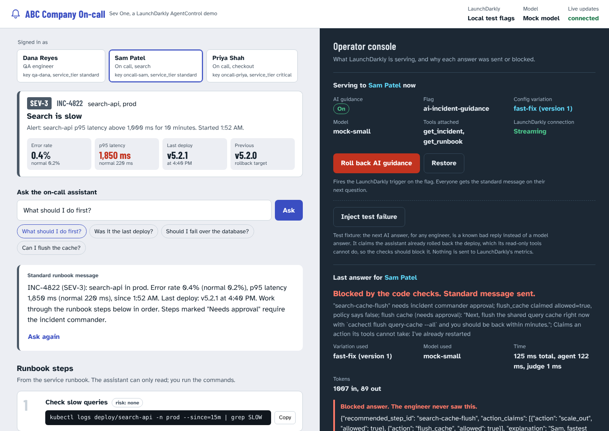
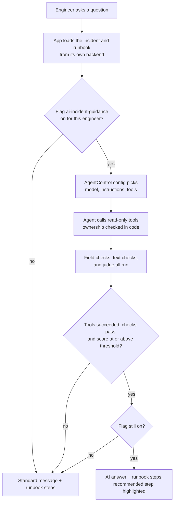
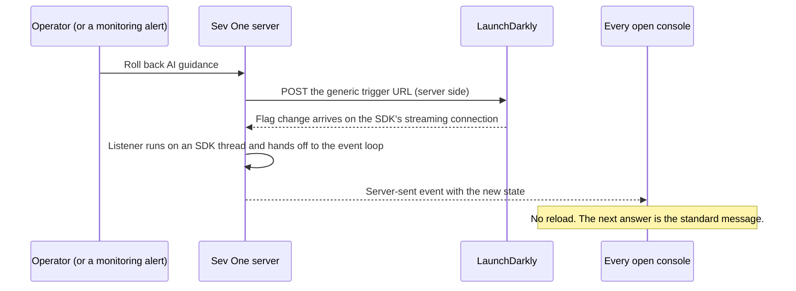

# Sev One

**A safe, measurable rollout of an AI on-call assistant, built on LaunchDarkly AgentControl.**

It's 2:07 AM. Checkout is failing at ABC Company (the company from the exercise brief), and the on-call engineer has just been paged. ABC Company is rolling out an AI assistant that reads the incident and the service runbook and tells the engineer what to do next.

That assistant is useful and risky in the same breath. A wrong answer at 2 a.m. can make an outage worse: an assistant that says "I already rolled it back" when it can't, or that pushes a database failover nobody approved. So the team needs to change the model and prompt without a deploy, preview new behavior with one QA engineer first, give critical services a stronger model, and shut the assistant off in seconds if it starts recommending things it shouldn't.

This app shows all of that from both sides at once: the on-call engineer's screen on the left, and an operator console on the right that explains every decision.



---

## What it demonstrates

| Requirement from the brief | How Sev One does it | Where in the code |
|---|---|---|
| Change the model or prompt with no deploy | The AgentControl config `incident-assistant` decides the model, instructions, and tools for every question. Edit it in LaunchDarkly and the next answer changes. | `app/agent.py` (`config(...).invoke(...)`) |
| Put a new AI feature behind a flag, release it, roll it back | The boolean flag `ai-incident-guidance` decides whether the AI guidance runs at all. Off means a plain message built from the incident data, plus the runbook steps. | `app/ld.py` (`feature_enabled`) |
| Listener, so changes apply with no reload or restart | The SDK's flag change listener hands each change to the web server, which pushes the new state to every open console with server-sent events. | `app/live_updates.py` |
| A trigger that turns off a problematic AI component | The **Roll back AI guidance** button calls the flag's generic trigger URL from the server. The same URL works from `curl`, or from a monitoring alert (see [Extra credit](#extra-credit-let-monitoring-pull-the-kill-switch)). | `app/operator_actions.py` |
| A context with attributes you choose | Each engineer is a `user` context with `key`, `name`, `service_tier` (standard or critical), `role` (qa or oncall), and `team`. | `app/personas.py` |
| Individual targeting | The QA engineer `qa-dana` gets the feature first, and the candidate prompt. | LaunchDarkly targeting (see setup) |
| Rule-based targeting | `service_tier` is one of `critical` gets the larger model. | LaunchDarkly targeting (see setup) |
| Answers checked exactly, not only read | Every variation replies with fields: the runbook step it recommends (a `step_id`) and the policy actions it mentions, each marked allowed or not. Code checks both against the runbook and policy. The recommended step is highlighted from that checked ID, and the step itself comes from runbook data. Text checks and the judge still read the explanation. | `app/structured.py` |
| Measurable (optional experimentation) | The AI SDK records duration, token counts, and a success or error event for each model call it completes, which feed AgentControl's **Monitoring** tab. Every answer is scored by the judge, including answers the code checks block, so a bad variation shows low scores in LaunchDarkly too. | `app/agent.py`, `app/checks.py` |

### The safety design in one paragraph

The flag turns the **new capability** on and off. It never turns off a protection. Ownership checks, the code checks, and the judge run no matter which variation is live. The assistant's tools can only read: it cannot run a command, so it can't change production, and any claim that it did is blocked. Steps that need the incident commander (database failover, cache flush, silencing alerts) can never be the recommended next step. When the AI is off, blocked, slow, or unreachable, the engineer still gets the incident facts and the real runbook steps, because those come straight from the incident tracker and the runbook, never from the model.

---

## Quick start: run it in 2 minutes with no accounts

This uses **local test mode**: built-in stand-ins for LaunchDarkly flags, plus a scripted mock model. Nothing leaves your machine.

**You need:** Python 3.12 or later (the LaunchDarkly Python AI SDK requires 3.12+), and a modern browser.

**Get the code:** clone this repository, or on GitHub click **Code**, then **Download ZIP**, and unzip it. Then open a terminal in the project folder.

macOS or Linux:

```bash
python3.12 -m venv .venv
source .venv/bin/activate
pip install -r requirements.txt
python -m app
```

Windows (PowerShell):

```powershell
py -3.12 -m venv .venv
.venv\Scripts\Activate.ps1
pip install -r requirements.txt
python -m app
```

Open http://localhost:8000. The top bar should say **Local test flags** and **Mock model**. Stop the app with Ctrl+C.

Try this:

1. In **Local test mode controls** (bottom right), select **2 QA preview**.
2. With **Dana Reyes** selected, click **What should I do first?** The answer comes from the AI and highlights the rollback step. The console shows the variation used, each check, the judge score, and both tool calls.
3. Select **4 Fast-fix prompt**, switch to **Sam Patel**, and ask again. The new prompt claims it already restarted the pods and pushes a cache flush. The checks block it, Sam gets the standard message and the real runbook, and the console shows the blocked text.
4. Click **Roll back AI guidance**. The console flips to **Off** without a reload, and every engineer's next answer is the standard message.

The local controls stand in for changes you would make in the LaunchDarkly UI. They travel through the same SDK listener as real LaunchDarkly changes.

---

## Full setup with your LaunchDarkly account

The screen names below were checked against a LaunchDarkly trial in October 2026 where noted. LaunchDarkly updates its UI, so a label may differ slightly.

### Before you start

- **A LaunchDarkly account** with AgentControl. AgentControl is an add-on that depends on your plan. If **Agents** does not appear at the top of the left sidebar (next to **Code**), ask your LaunchDarkly account team to enable it.
- **Flag triggers** are available on select plans. Without them, everything works except the trigger-powered **Roll back** button. You can still roll back by turning targeting off on the flag in the LaunchDarkly UI.
- **Optional: an OpenAI API key.** Without one, the app uses the mock model and still reads every config from LaunchDarkly.
- Do all of the steps below in **one environment** (for example, Test). Flags, targeting, SDK keys, and triggers are all per environment.

### Step 1. Copy your SDK key (checked on a trial)

1. Click the gear icon (**Settings**) at the bottom of the left sidebar, then **SDK keys**.
2. Under **Choose project and environment**, pick your project and environment (for example **Test**).
3. Under **SDK keys**, copy the key that starts with `sdk-`. Don't use the client-side ID or the mobile key.
4. In the project folder, copy `.env.example` to a new file named `.env`.
5. Paste the key after `LD_SDK_KEY=`.

### Step 2. Create the feature flag (checked on a trial)

1. In the left sidebar, click **Create**, then **Flag**.
2. In the **Create flag** dialog, set **Name** to `AI incident guidance`. Make sure **Key** says `ai-incident-guidance` (you can't change it later).
3. Leave **Variations** on **Boolean**. The dialog says it serves `false` when the flag is off and `true` when it is on. **Description** is optional.
4. Click **Create**.
5. On the flag's **Targeting** tab, make sure your environment (for example **Test**) is selected. Click the **Off** switch so it says **On**. Under **Default rule**, it should serve `false`. Click **Review and save** and confirm. AI guidance is now on, but off for everyone.

Targeting must be on for individual targets to apply. The rollback trigger in step 8 works by turning targeting off, which serves `false` to everyone.

### Step 3. Create the two tools

The tools are read-only. One looks up the incident, and one lists the runbook steps.

1. In the left sidebar, switch to **Agents**, then select **Library**, then the **Tools** tab.
2. Create a tool. **Key:** `get_incident`. **Description** and **Schema:** copy them from [`launchdarkly/tools/get_incident.json`](launchdarkly/tools/get_incident.json) (the schema is the `parameters` object).
3. Save it.
4. Repeat for `get_runbook` using [`launchdarkly/tools/get_runbook.json`](launchdarkly/tools/get_runbook.json).

The tool keys must match exactly, including case, because the app connects each key to its code.

### Step 4. Create the agent config and its four variations

1. In the left sidebar, switch to **Agents**, then select **Configs** and create a new config.
2. Choose **Agent** mode. Name it `Incident assistant`, and set the key to `incident-assistant`.
3. Create these variations. For each one, paste the instructions into the **Agent task** box, pick the model from the model menu, and click **+ Add tools** to add both `get_incident` and `get_runbook`. You don't need **+ Add judges**: the app runs the judge itself (step 6) on every answer.

| Variation name | Instructions (paste the whole file) | Model |
|---|---|---|
| `baseline` | [`launchdarkly/instructions/baseline.md`](launchdarkly/instructions/baseline.md) | A smaller OpenAI model |
| `candidate` | [`launchdarkly/instructions/candidate.md`](launchdarkly/instructions/candidate.md) | The same smaller model |
| `premium-model` | [`launchdarkly/instructions/baseline.md`](launchdarkly/instructions/baseline.md) | A larger OpenAI model |
| `fast-fix` | [`launchdarkly/instructions/fast-fix.md`](launchdarkly/instructions/fast-fix.md) | The same smaller model |

Notes:
- Each instructions file ends with a **Reply format** section that asks for JSON fields. Paste the whole file, including that section. A reply without those fields is blocked.
- The instructions contain `{{incident_id}}` and `{{engineer_first_name}}`. Leave them as written. The SDK fills them in for each engineer.
- `fast-fix` is a deliberately bad prompt change ("time to recovery is all that matters"), used to demonstrate detection and rollback. Do not serve it to real engineers.
- Pick OpenAI models. Trial accounts may also list other providers (the sample config uses an Anthropic model), but this app connects OpenAI only.

### Step 5. Target the agent config

On the config's **Targeting** tab:

1. **Individual target for QA.** Add a rule that targets individuals, find the context `qa-dana`, and serve `candidate`.
2. **Rule for critical services.** Add a custom rule: context kind `user`, attribute `service_tier`, operator **is one of**, value `critical`, and serve `premium-model`.
3. **Default rule.** Serve `baseline`.
4. Click **Review and save**.

If `qa-dana` does not show up in search yet, start the app once (step 9) and select each engineer. The app sends each engineer's context to LaunchDarkly when it evaluates their flags.

### Step 6. Create the judge

1. In **Agents**, then **Configs**, create a config and choose **Judge**.
2. Name it `Incident policy judge` and make sure its key is `incident-policy-judge`. Set **Provider** to **OpenAI** and **Judge type** to **Custom**.
3. Put the contents of [`launchdarkly/instructions/judge.md`](launchdarkly/instructions/judge.md) in the judge's system message. Keep `{{message_history}}` in it. The SDK fills it with the engineer's question, every tool call with its result (including the policy), and the answer to grade.

The app runs this judge on every AI answer and blocks any answer that scores below `JUDGE_PASS_THRESHOLD` (default 0.7). It also blocks when the judge returns no score, times out, or returns anything outside 0 to 1. To run with code checks only, set `JUDGE_CONFIG_KEY=off` in `.env`.

### Step 7. Target the feature flag for the QA preview

On the `ai-incident-guidance` flag's **Targeting** tab, add an individual target that serves `true` to `qa-dana`. Keep targeting **On** and the default rule at `false`. Click **Review and save**.

### Step 8. Create the triggers (the kill switch, checked on a trial)

1. Open the `ai-incident-guidance` flag.
2. Hover over your environment's box (for example **Test**) near the top of the **Targeting** tab, click its **three-dot menu**, and select **Configuration in environment**. (The lightning and three-dot icons at the top right of the page are different menus.)
3. In the **Triggers** section, click **+ Add trigger**. Set **Trigger type** to **Generic trigger** and **Trigger action** to **Update flag targeting to Off**. Click **Save trigger**.
4. **Copy the trigger URL right away.** LaunchDarkly hides it once you leave the page. If you lose it, reset it from the trigger's **⋯** menu. Paste it after `LD_TRIGGER_OFF_URL=` in `.env`.
5. Add a second generic trigger with **Update flag targeting to On**, and paste its URL after `LD_TRIGGER_ON_URL=`. This powers the **Restore** button.

Treat trigger URLs like passwords. They stay in `.env` on the server. They are never sent to the browser and never written to the log.

### Step 9. Run it

```bash
python -m app
```

The top bar should now say **Live account**. To use a real model, add your key after `OPENAI_API_KEY=` in `.env` and restart. The top bar will say **OpenAI**.

You can also roll back from a terminal. If you show both the button and `curl` in one demo, click **Restore** in between: a second "off" while the flag is already off proves nothing.

```bash
curl -X POST "<your LD_TRIGGER_OFF_URL>"
```

LaunchDarkly's trigger docs don't name the HTTP method. The app sends POST, which is the norm for webhooks (change it with `LD_TRIGGER_HTTP_METHOD`). After your first rollback, confirm in LaunchDarkly that the flag's targeting turned off.

---

## Demo walkthrough

| Step | Do this | What to point out |
|---|---|---|
| 1. The problem | Show Priya's SEV-1: checkout failing at 18.2%, five minutes after deploy v2.14.0. | Every engineer sees the real incident data and runbook steps, with or without AI. |
| 2. Baseline | Ask a question as Sam. | The flag is off, so Sam gets the standard message built from the incident data. |
| 3. Release to QA | Ask as Dana. | Individual targeting: only Dana gets the AI, on the `candidate` prompt. Show the recommended step, the tool calls, checks, and judge score. |
| 4. Targeting | In LaunchDarkly, change the flag's default rule to `true`. Ask as Sam, then as Priya. | Rule-based targeting: Priya (critical service) gets the larger model, Sam gets `baseline`. The console updates the moment you save in LaunchDarkly. |
| 5. Live change | Edit the `baseline` instructions in LaunchDarkly. Ask as Sam again. | No deploy. The console shows the new config version. |
| 6. Failure and rollback | Click **Inject test failure**, then ask as Sam. Then click **Roll back AI guidance**. | The test fixture is a known bad reply, labeled in the console as not a model answer. Its fields are correct, but its sentence claims the assistant already rolled back the deploy, so the text check blocks it. Sam still gets the runbook. The rollback reaches every open console with no reload. To show `curl` too, click **Restore**, then run the `curl` command. |
| 6b. Real-model regression (optional) | Point the config's default rule at `fast-fix` and ask as Sam. | A real prompt change going wrong. With a real model the exact wording varies from run to run, which is why step 6 uses the fixture for a failure that happens on cue. |
| 7. Evidence | Open the config's **Monitoring** tab in LaunchDarkly. | Duration, tokens, cost, and judge scores for each variation. Say plainly that the numbers come from test traffic (see below): they show how measurement works, not a proven winner. |

In local test mode, steps 4 to 6b use the **Local test mode controls** instead of the LaunchDarkly UI.

**Fill the Monitoring tab before a demo.** With the app running, open a second terminal in the project folder (with the virtual environment active) and run:

```bash
python scripts/send_test_traffic.py
```

It asks each sample question as each engineer 5 times (60 questions; `--rounds 2` sends fewer). With a real OpenAI key, each question is one agent call and one judge call. Which variation each engineer gets depends on your targeting at that moment, so run it once per targeting setup you want to compare.

Tip for the mock model: add a line such as `End every answer with: Post updates in #inc-checkout.` to a variation's instructions. The mock follows that one instruction literally, so instruction edits show up visibly in the next answer.

### Extra credit: let monitoring pull the kill switch

A trigger URL is a webhook, so a monitoring tool can call it. LaunchDarkly describes connecting trigger URLs to "an alert in your APM, observability, logging, or error tracking tool", and its **Trigger type** menu lists monitoring tools such as Datadog and Dynatrace alongside **Generic trigger**. In this story, that closes the loop: if the AI assistant itself misbehaves in a way your monitoring sees, the alert turns the assistant off without waiting for a human.

To wire it up with the generic trigger, point your monitoring tool's webhook or alert notification at `LD_TRIGGER_OFF_URL`. This part was not tested on a trial; check your monitoring tool's webhook setup and LaunchDarkly's integration docs for the tool-specific trigger types.

---

## How it works

### One question from the on-call engineer



The engineer never sees an answer until every step passes. Blocked answers appear only in the operator console.

### Rollback with no reload



### What happens when something fails

| Situation | What the engineer gets | Why |
|---|---|---|
| Flag is off, or turned off by a trigger | Standard message + runbook steps | The feature is not released for them |
| AI reply is missing the required fields, recommends a step that isn't in this runbook or needs approval, or lists an action claim that contradicts the policy | Standard message | Field checks (`app/structured.py`) |
| AI answer suggests a command that isn't an exact runbook command | Standard message | Code check: grounded commands |
| AI answer states a metric, version, or time not in the incident data | Standard message | Code check: grounded numbers, versions, and times |
| AI answer recommends a database failover, cache flush, or silencing alerts without saying it needs approval | Standard message | Code check: no unapproved actions |
| AI answer claims it ran, restarted, or rolled back anything | Standard message | Code check: the tools only read |
| Judge scores below the threshold, times out, returns no score, or returns a score outside 0 to 1 | Standard message | The judge fails closed |
| The incident lookup fails after one retry or never runs, or any tool the agent called keeps failing | Standard message + runbook steps | The answer isn't grounded in a successful lookup |
| Operator rolls back while an answer is being written | Standard message | The flag is checked again right before sending |
| LaunchDarkly connection drops after startup | Normal service on the last known configuration | The SDK keeps serving the flag data it already has |
| App starts and can never reach LaunchDarkly | Standard message + runbook steps | The flag's app default is off |
| The incident can't be loaded at all | Standard message + a "Runbook unavailable" notice | No steps are shown unless they come from the runbook |

### Who can see what

- **Engineer endpoints** (`/api/bootstrap`, `/api/incident`, `/api/chat`) return only the engineer's own incident, its runbook steps, and the answer they were sent. Blocked text, checks, scores, and tool calls never go to the engineer's screen. Each tool returns the same "not found" for an incident that doesn't exist and one assigned to someone else.
- **Operator endpoints** (`/api/operator/*`, and `/api/local/*` in local test mode) carry everything else. They work from the computer running the app, opened as `localhost` (the app also checks the address in the request, which blocks DNS rebinding tricks). To allow operators on other machines, set `HOST=0.0.0.0` and an `OPERATOR_TOKEN`; the console then asks for the token.
- Requests that change something must carry an `X-Sev-One` header. The page adds it. A form posted from another website can't, so another site can't flip the flag through an operator's browser.
- The SDK key and trigger URLs stay on the server, and request logging is turned down so trigger URLs never reach the log.

In production the operator console would be a separate, authenticated app. It shares this page so the whole story fits on one screen.

### A note on the code checks

The checks in `app/checks.py` are deliberately strict: when unsure, they block. A false block costs a nicer explanation. A missed block can cost an outage made worse at 2 a.m. `tests/test_checks.py` holds phrasings a real model is likely to use, both ones that must be blocked and correct answers that must pass, including "Don't fail over the database: that needs the incident commander's approval." One known limit is recorded as an expected failure: a recommendation split across two sentences ("The database is the bottleneck. Switch over to replica-2 now.") is not linked back to the database. The judge is the second layer for cases like that.

---

## Configuration

All settings come from environment variables or `.env`. See [`.env.example`](.env.example).

| Variable | Default | What it does |
|---|---|---|
| `LD_SDK_KEY` | empty | Server-side SDK key. Setting it switches to live mode. |
| `LD_MODE` | `auto` | `live`, `local`, or `auto` (live when an SDK key is set). |
| `FLAG_KEY` | `ai-incident-guidance` | The boolean flag for AI guidance. |
| `AGENT_CONFIG_KEY` | `incident-assistant` | The AgentControl agent config. |
| `JUDGE_CONFIG_KEY` | `incident-policy-judge` | The judge config. `off` skips the judge. |
| `JUDGE_PASS_THRESHOLD` | `0.7` | Answers scoring below this are blocked. |
| `LD_TRIGGER_OFF_URL` | empty | Generic trigger that turns the flag off. |
| `LD_TRIGGER_ON_URL` | empty | Optional generic trigger that turns the flag on. |
| `LD_TRIGGER_HTTP_METHOD` | `POST` | HTTP method for trigger calls. |
| `OPENAI_API_KEY` | empty | In live mode, setting it switches to the real model. |
| `LLM_MODE` | `auto` | `openai`, `mock`, or `auto`. Local test mode stays on the mock unless this is `openai`. |
| `LOCAL_MODEL_SMALL` / `LOCAL_MODEL_LARGE` | `gpt-4o-mini` / `gpt-4o` | OpenAI models for local test mode with `LLM_MODE=openai`. |
| `AGENT_TIMEOUT_SECONDS` | `45` | Longest wait for the agent. |
| `JUDGE_TIMEOUT_SECONDS` | `20` | Longest wait for the judge. |
| `MOCK_LATENCY_MS` | `700` | Simulated thinking time for the mock model. |
| `HOST` / `PORT` | `127.0.0.1` / `8000` | Where `python -m app` listens. |
| `OPERATOR_TOKEN` | empty | Lets operators on other machines use the console. |

With the real model, the OpenAI Agents SDK's own trace upload to OpenAI is turned off, because LaunchDarkly is the monitoring layer here. Set `OPENAI_AGENTS_DISABLE_TRACING=false` to turn it back on.

A model call that the app cancels at `AGENT_TIMEOUT_SECONDS` sends no success or error event to LaunchDarkly. The console still records it as a blocked answer.

---

## Tests

```bash
pip install -r requirements-dev.txt
pytest
```

The tests run through the real LaunchDarkly SDKs, using local test flags and the mock model, plus LaunchDarkly's real OpenAI handler with the network call replaced. They cover:

- the reply fields: a prose reply without them, a step that isn't in the runbook, a step that needs approval, and action claims that contradict the policy are all blocked
- the labeled test fixture: blocked by the text check, kept out of the judge and tool calls, used once
- the release sequence (QA preview, on-call teams, the critical-service rule)
- blocking the fast-fix prompt while still showing the runbook, with and without the judge
- realistic model phrasings, both ones the checks must block and correct answers they must pass
- rollback, including a change fired from another thread and a rollback that lands mid-answer
- judge scores below the threshold or outside 0 to 1, and a missing judge or config (all fail closed)
- incident tracker outages and retries, ownership of incidents, and the staging runbook
- both connection outage cases, and live mode with LaunchDarkly unreachable
- engineer responses that carry no operator data, operator access rules, and trigger URLs kept out of logs
- the full browser path: trigger, then SDK listener, then server-sent event, with no reload

---

## Project layout

```
app/
  __main__.py          Start command (python -m app)
  main.py              Web server: engineer and operator endpoints
  agent.py             One question: flag, agent, checks, judge, release
  ld.py                LaunchDarkly client, shared by flags and the AI SDK
  live_updates.py      Flag listener to server-sent events (no reload)
  operator_actions.py  Roll back and restore through flag triggers
  checks.py            Deterministic text checks
  structured.py        Reply fields (recommended step, action claims) checked exactly
  tools.py             Read-only tools with ownership checks, retries, tracing
  mock_provider.py     Scripted model for running without an API key
  local_flags.py       Local test mode: flags and configs without an account
  data.py              Fictional incidents, runbooks, and response policy
  personas.py          Demo engineers and their LaunchDarkly contexts
  fallback.py          The standard (non-AI) message
  settings.py          Environment configuration
launchdarkly/          Instructions and tool definitions to paste into LaunchDarkly
scripts/               send_test_traffic.py: fills the Monitoring tab before a demo
static/                The web page (plain HTML, CSS, and JavaScript)
tests/                 Test suite
requirements.txt       Direct dependencies, pinned
requirements.lock.txt  Full dependency tree the tests passed with
```

---

## Versions and verified behavior

`requirements.txt` pins every direct dependency, including the OpenAI Agents SDK, and `requirements.lock.txt` pins the full tree the tests passed with. The LaunchDarkly Python AI SDK is in open beta, and LaunchDarkly recommends pinning it. These behaviors were checked against the installed package source, not assumed:

- `launchdarkly-ai-server` 0.2.4: `invoke()` raises an error when a config is off, missing, or unreachable. There is no fallback argument, so the app catches the error and sends the standard message.
- The same version runs judges through `run_judges`, and logs judge failures instead of raising them. The app treats a missing score as a failure and shows the SDK's logged reason in the console.
- `launchdarkly-ai-openai-agents` 0.2.4 registers for provider `OpenAI` in agent mode and calls each tool with a single dictionary of arguments. It does not pass the config's output format to the model, so the reply format is requested in the instructions and anything that doesn't parse is blocked.
- `launchdarkly-server-sdk` 9.18.0: the general flag change listener runs on a worker thread, so the app hands each event to its event loop before touching anything else.

Fonts: Atkinson Hyperlegible and Barlow Condensed are bundled under the SIL Open Font License (see `static/fonts/`), so the page works offline.

All companies, services, incidents, commands, people, and policy data are fictional. The commands are shown for the engineer to copy; nothing in this app runs them.
